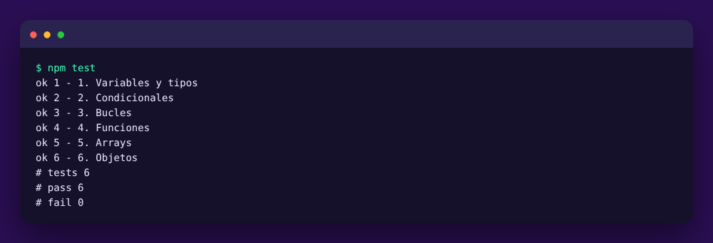

# JS Fundamentos

 

20 ejercicios resueltos de fundamentos de JavaScript (variables, condicionales, bucles, funciones, arrays y objetos) con pruebas automáticas.



## 🛠️ Tecnologías

- JavaScript (ES Modules)
- Node.js test runner

## ▶️ Cómo ejecutarlo

Necesitás Node.js 18 o superior.

```bash
npm test
```

Para practicar: abrí `docs/EJERCICIOS.md`, borrá el cuerpo de una función en `src/fundamentos.js` y volvé a escribirla hasta que el test pase.

## 🧠 Lo que practiqué

- Tipos de datos y `typeof`
- Condicionales y operadores lógicos
- `for`, `while`, `for...of`
- Arrow functions y closures
- `map`, `filter`, `reduce`, `Set`
- Objetos como diccionarios
- Testing con `node:test`

## 📁 Estructura

```
src/fundamentos.js        # soluciones comentadas
tests/fundamentos.test.js # pruebas automáticas
docs/EJERCICIOS.md        # enunciados
docs/                   # documentación
images/                 # capturas
version_history/        # historial de cambios
```

## 🚀 Próximas mejoras

- [ ] Agregar ejercicios de recursión
- [ ] Ejercicios de strings y expresiones regulares
- [ ] Medir cobertura de tests

## 👩‍💻 Autora

**Estela Oviedo Cortez** — Desarrolladora Full Stack en formación.
[LinkedIn](https://www.linkedin.com/in/estela-oviedo-cortez-796303228) · [GitHub](https://github.com/Rumenco1221)

## 📄 Licencia

MIT. Ver [LICENSE](LICENSE).
